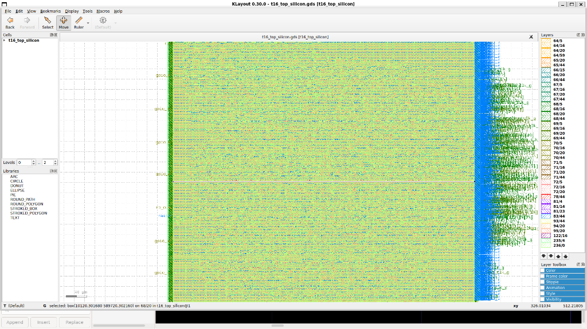
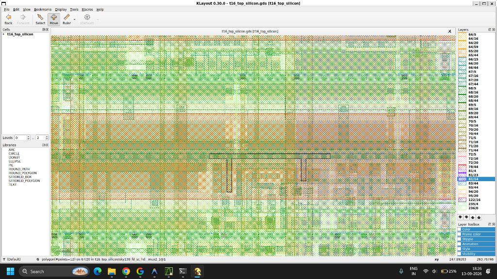

# 🚀 TELUGU-16 (T-16 V4.1)

[](https://github.com/The-OpenROAD-Project/OpenLane)
[](https://github.com/google/skywater-pdk)
[](https://en.wikipedia.org/wiki/Verilog)
[](https://tinytapeout.com/)

**An open-source, fully synthesizable 16-bit RISC System-on-Chip (SoC) designed for the SkyWater 130nm (Sky130) open-source PDK.**

The TELUGU-16 (T-16 V4.1) is a custom processor architecture built entirely from scratch. It goes beyond a simple CPU by incorporating a unique, memory-mapped **Probabilistic Bit (P-Bit)** generated via thermal noise from a 15-stage Ring Oscillator. This repository contains the complete RTL, testbenches, software toolchain (Assembler), and the full OpenLane flow scripts used to generate the final factory-ready GDSII layout.

---

## 🌟 Key Features

* **16-bit RISC Core:** Custom Instruction Set Architecture (ISA) with 16-bit opcodes and 16-bit data paths.
* **On-Chip Memory Subsystem:** 
  * 256-word Program ROM (bakes assembly programs directly into silicon logic gates).
  * 128-word Data RAM.
* **Stochastic Computing (P-Bit):** A 15-stage odd-inverter Ring Oscillator generates high-frequency pulses that are sampled by a synchronizer to generate true hardware randomness (P-Bit), memory-mapped for the CPU to read.
* **Hardware Timer:** Built-in memory-mapped 16-bit prescaler and timer for precise execution control.
* **Full RTL-to-GDS Flow:** Completely compatible with OpenLane 1.x and the Sky130 PDK.
* **TinyTapeout Compatible:** Wrapped in the standard `tt_um` interface for submission to multiproject wafer (MPW) shuttles.

## 📸 Physical Layout (Sky130)

The T-16 was synthesized, placed, and routed using OpenLane. The final design utilizes over 6,400 standard logic cells packed into a 590x590 µm core area.

### Full Die Shot (GDSII)


### Standard Cell Routing (Zoomed)


*(These are actual screenshots from KLayout viewing the `t16_top_silicon.gds` generated by this repository).*

---

## 🏗️ Architecture

The system is designed around a central 16-bit ALU and Control Unit, communicating with peripherals over a unified memory-mapped bus.

 *(See `docs/ARCHITECTURE.md` for Mermaid diagrams of the SoC architecture and the RTL-to-GDS flow).*

---

## 📂 Repository Structure

* `rtl/`: The synthesizable Verilog source code for the CPU, Memories, Peripherals, and TinyTapeout wrapper.
* `tb/`: Simulation testbenches, including full ISA verification and Fibonacci sequence validation.
* `sw/`: Example Assembly programs (`program_fib.asm`, `program_pbit.asm`) and their compiled `.hex` binaries.
* `tools/`: Python utilities, including the custom `t16asm.py` Assembler and `bake_rom.py`.
* `spice/`: SPICE decks for analog simulation of the Ring Oscillator's temperature dependence.
* `docs/`: Extensive documentation, the ISA reference card, and the Master Guide.
* `openlane_results/`: The final extracted `.gds`, gate-level netlist `.nl.v`, and metrics from the physical build.

---

## 🚀 Getting Started

### 1. Simulating the Design
You can run the full test suite using standard open-source tools (Icarus Verilog & GTKWave):
```bash
bash run_sim.sh
```

### 2. Writing Custom Software
Write your code in `sw/input.asm` using the custom T-16 instruction set, then compile it:
```bash
python3 tools/t16asm.py sw/input.asm sw/output.hex
```

### 3. Baking the ROM
To permanently wire your program into the silicon:
```bash
python3 tools/bake_rom.py sw/output.hex
```

### 4. Running the ASIC Flow (OpenLane)
Assuming you have OpenLane installed via Docker:
```bash
# Set up the design folder
bash run_openlane.sh

# Enter OpenLane and build
cd ~/OpenLane
make mount
./flow.tcl -design telugu_t16_v4
```

---

## 📜 Master Guide
For a deeply detailed, 34-part explanation of exactly how this chip was designed, the philosophy behind the P-bit, and a full glossary of ASIC design terms, read the **[T-16 Complete Guide](COMPLETE_GUIDE.md)** included in this repository.

---

## 👨‍💻 About the Creator

**Ginnela Someswara Sai Ram Prasad**  
*Electronics & Communication Engineering Student | VLSI Designer | AI Developer*

The TELUGU-16 architecture is the brainchild of Ginnela Someswara Sai Ram Prasad. Driven by a passion for solving complex engineering challenges through direct logic and strategic problem-solving, this project represents the intersection of deep digital logic design, hardware simulation, and modern open-source silicon manufacturing.

Beyond custom silicon and ASIC design, Ginnela's engineering portfolio spans:
* **Hardware & IoT:** Proposal architect for a subsurface drainage IoT sanitation grid (MSME Idea Hackathon 6.0).
* **Research & Academia:** Author of the preprint paper *"A Next-Generation Framework for Ultra-Long-Distance Communications"* (ScienceOpen, 2025) and Phase 2 Qualifier in the highly competitive Viasat Space for Good India Challenge.
* **AI & Software Development:** Creator of the **EvoSkill AI** web platform and the tilt-responsive **MotionRead** Android application.

**Connect & Explore:**
* 🌐 Portfolio: [ginnela.in](http://ginnela.in)
* 🤖 EvoSkill AI: [evoskill.ginnela.in](http://evoskill.ginnela.in)
* 📧 Open to collaboration on advanced VLSI, IoT, and AI-integrated hardware projects.

---
*Built with passion, logic gates, and a touch of thermal noise by Ginnela Someswara Sai Ram Prasad.*
