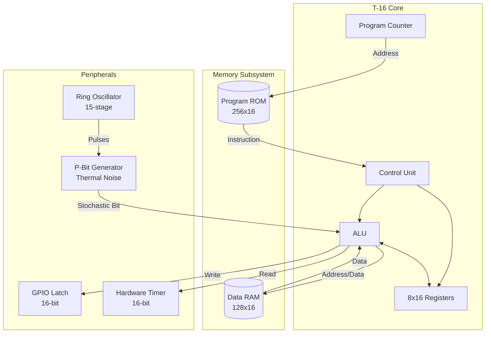
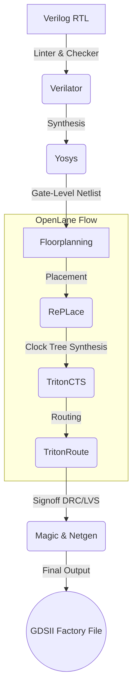

# T-16 SoC Architecture

The TELUGU-16 (T-16 V4.1) is a 16-bit RISC System-on-Chip designed for the SkyWater 130nm process. It features a custom instruction set, on-chip ROM and RAM, and experimental stochastic hardware (P-bit).

## System Block Diagram

## RTL-to-GDS Flow

